<a id="top"></a>

# 🛡️ Change Guardian

**A human-in-the-loop AI incident triage agent for payment-network operations.**

A Dynatrace problem comes in. Change Guardian collapses its alert cascade into one incident, picks the probable cause, routes it, pulls the exact SOP branch and the closest past tickets, drafts the Remedy ticket, and tags every proposed step by risk. A local fine-tuned language model writes the summary and next steps, but only from that verified context. An engineer approves, edits, or escalates, and every decision lands in a tamper-evident audit log.

Built by the UGA FinTech Capstone team (Fall 2026) for Mastercard Business Operations as the *AI Agent Example* deliverable. It is evidence for the team's research, not a production system.

[](https://github.com/yoshnaagarwal23/change-guardian/actions/workflows/tests.yml)


<details>
<summary>📖 Table of Contents</summary>
<br />

- [The problem](#the-problem)
- [Value Proposition Canvas](#value-proposition-canvas)
- [What it does](#what-it-does)
- [Quickstart](#quickstart)
- [Usage](#usage)
- [Live demo script](#live-demo-script)
- [Results](#results)
- [Fine-tuning the local model](#fine-tuning-the-local-model)
- [Design decisions](#design-decisions)
- [Data contract](#data-contract)
- [Repository layout](#repository-layout)
- [Limitations](#limitations)
- [Roadmap and ownership](#roadmap-and-ownership)

</details>

## The problem

Mastercard switched 175.5 billion transactions in 2025. Keeping that platform up is the "Run" side of technology, and the sponsor team described where it hurts:

- **Alert cascades.** When one database slows, every service that depends on it fires its own critical alert. Engineers get paged once per symptom and have to find the cause by hand on a bridge call. The team handles tens of thousands of alerts a month.
- **The SOP labyrinth.** Remediation steps live in long SOPs and old tickets. Under pressure nobody has time to read twelve pages to find the three steps that apply.
- **AI that costs more than it saves.** Squads build overlapping AI wrappers, token bills grow faster than the savings, and output that takes longer to verify than to do by hand is a net loss.
- **No unverified changes in production.** Payment systems tolerate no autonomous production action. Any AI must stop at "recommend" and leave "execute" to a person.

Change Guardian is one worked answer to *where AI pays off in Business Operations*: correlation, routing, and retrieval stay deterministic and free, a small local model writes only what needs language, and governance is built in rather than added later.

## Value Proposition Canvas

The right half is the sponsor (Mastercard Business Operations / SRE on-call engineers), taken from the sponsor meetings and the team's research. The left half is what this product does about it. The **Where** column points to the code.

### Customer profile

| | |
|---|---|
| **Customer jobs** | Detect and triage incidents fast (cut MTTM) · find the real root cause in a cascade · follow the right SOP · route to the right team at the right priority · decide which changes are safe · prove to auditors what was done and by whom · justify every AI dollar to leadership |
| **Pains** | One fault pages many times · cause buried under symptom alerts · 12-page SOPs and drifting documentation · SOP lookup during live outages · LLM hallucinated steps and permission leakage · verification takes longer than doing it by hand · token cost and duplicated AI tooling · zero tolerance for unapproved production changes · audit evidence pulled together after the fact |
| **Gains** | One actionable card per incident · the exact remediation branch, with citations · consistent priority and routing · security issues flagged to SecOps automatically · audit evidence as a by-product · measurable KPIs (pages avoided, SOP coverage, cost per triage) · a pattern other squads can reuse |

### Value map

| Products and services | |
|---|---|
| Triage agent | Problem in, action card + draft Remedy ticket out ([`src/agent.py`](src/agent.py)) |
| Live console | Streamlit feed, card, Approve / Edit / Escalate / Reject ([`app.py`](app.py)) |
| Triage API | FastAPI endpoints a ticketing tool or webhook can call ([`src/api.py`](src/api.py)) |
| Local fine-tuned model | Qwen2.5 + LoRA trained on the client's own tickets ([`src/train_lora.py`](src/train_lora.py)) |
| Evaluation kit | Contract checks, model metrics, human rating sheet, KPI report ([`src/evaluate.py`](src/evaluate.py), [`src/metrics.py`](src/metrics.py), [`src/kpis.py`](src/kpis.py)) |

| Pain | Pain reliever | Where |
|---|---|---|
| One fault pages many times | Alert correlation: one page per problem, probable cause picked, symptoms and telemetry gaps suppressed, related problems on the same entity linked | [`src/correlate.py`](src/correlate.py) |
| SOP labyrinth | Picks the SOP *and the matching remediation branch* (disk vs CPU vs runaway process) and shows past tickets with how often each was seen | [`src/knowledge.py`](src/knowledge.py) |
| Hallucinated steps | The model sees only the SOP and precedents; each proposed step is checked against them and dropped if ungrounded; if nothing survives, the deterministic draft is used | [`src/agent.py`](src/agent.py), [`src/guardrails.py`](src/guardrails.py) |
| Verification overhead | Priority, team, and SOP come from rules that match 100% of the ticket history, so the reviewer checks only the summary and steps | [`src/tools.py`](src/tools.py) |
| Token cost | Local 0.5B model on a laptop, $0 per triage; rules-only mode costs nothing; tokens and cost are logged per card | [`src/llm.py`](src/llm.py), [`src/kpis.py`](src/kpis.py) |
| No unapproved production changes | Every step is tagged diagnostic / change / security; changes and security actions on production entities are locked behind approval; default-deny on what counts as production | [`src/guardrails.py`](src/guardrails.py) |
| After-the-fact audit evidence | Every decision is appended to a SHA-256 hash-chained log; editing history breaks the chain | [`src/guardrails.py`](src/guardrails.py) |

| Gain | Gain creator | Where |
|---|---|---|
| One actionable card | Probable cause, suppressed symptoms, SOP branch, precedents, risk-tagged steps, draft ticket on one screen | [`app.py`](app.py) |
| Security awareness | Authentication and brute-force signals raise a *notify SecOps* flag before any remediation | [`src/agent.py`](src/agent.py) |
| Documentation drift caught | Event types with no SOP are escalated and counted as documentation gaps | [`src/agent.py`](src/agent.py), [`src/kpis.py`](src/kpis.py) |
| Measurable ROI | Pages avoided, SOP coverage, escalation rate, approval share, latency, tokens, $ per run | [`src/kpis.py`](src/kpis.py) |
| Reusable pattern | One backend interface (rules / local HF / Claude) and one API, so another squad can plug in its own data | [`src/llm.py`](src/llm.py), [`src/api.py`](src/api.py) |
| Change-risk hook | Recent deployments on the affected entity are pulled into the card when a deploy log exists (Topic 1 add-on) | [`src/tools.py`](src/tools.py) |

## What it does

```mermaid
flowchart LR
    A[Dynatrace problem<br/>N alerts] --> B[Correlate<br/>probable cause +<br/>symptoms + gaps]
    B --> C[Route<br/>priority + team<br/>fixed rules]
    C --> D[Retrieve<br/>SOP branch +<br/>precedent tickets]
    D --> E{Model<br/>enabled?}
    E -- no --> G[Rules draft]
    E -- yes --> F[Local LLM writes<br/>summary + steps]
    F --> H[Grounding check<br/>drop invented steps]
    H -- nothing grounded --> G
    H --> I[Risk tags +<br/>approval plan]
    G --> I
    I --> J[Action card +<br/>draft Remedy ticket]
    J --> K{Engineer}
    K -- approve / edit / escalate / reject --> L[(Hash-chained<br/>audit log)]
```



Everything left of the model is deterministic, testable, and free to run. This follows Mastercard's Two Acid Tests: AI only where a script can't do the job, and only with verified data to check it against.

## Quickstart

Requires [uv](https://docs.astral.sh/uv/) (it installs Python 3.12 for you).

```bash
git clone https://github.com/yoshnaagarwal23/change-guardian.git
cd change-guardian
uv sync                         # core: rules engine, UI, API, tests
uv run pytest -q                # 35 tests, ~2 s
uv run streamlit run app.py     # opens the console at http://localhost:8501
```

To use the local model and fine-tuning as well:

```bash
uv sync --all-extras            # + torch, transformers, peft, mlflow, anthropic
```

> **Heads-up:** a plain `uv sync` or `uv add <pkg>` removes extras that aren't requested, including torch from under a running training job. Once you work with the model, always use `uv sync --all-extras` and `uv run --all-extras ...`.

Optional hosted comparison backend: put `ANTHROPIC_API_KEY=...` in `.env` (git-ignored).

<details>
<summary>Using pip instead of uv</summary>

```bash
python -m venv venv && source venv/bin/activate
pip install -r requirements.txt
PYTHONPATH=src pytest -q
```
</details>

## Usage

All commands run from the repo root.

| Task | Command |
|---|---|
| Rebuild processed data from `data/raw/` | `uv run python src/load_data.py` |
| Triage 5 problems, rules only | `uv run python src/agent.py --limit 5` |
| Triage with the local base model | `uv run python src/agent.py --backend hf --limit 5` |
| Triage with the fine-tuned adapter | `uv run python src/agent.py --backend hf --adapter models/lora-mac --limit 5` |
| Triage specific problems | `uv run python src/agent.py --problem P-261002 --problem P-261003` |
| Score agent output against the routing rules + make a rating sheet | `uv run python src/evaluate.py` |
| Run the live console | `uv run streamlit run app.py` |
| Run the API (optional, not used by the console) | `uv run uvicorn api:create_app --factory --app-dir src --port 8000` |
| Build fine-tuning data | `uv run python src/sft_data.py` |
| Fine-tune on a Mac | `uv run python src/train_lora.py --config configs/mac.yaml --eval-base` |
| See training runs | `uv run mlflow ui` |

Agent output goes to `outputs/agent_results.jsonl`, one card per line. Each card has the README contract fields plus reviewer context (probable cause, symptoms, step risk plan, warnings) and telemetry (backend, latency, tokens).

**API example**

```bash
curl -X POST localhost:8000/triage/P-261002
curl -X POST localhost:8000/decision -H 'content-type: application/json' \
     -d '{"problem_id":"P-261002","decision":"approved","user":"swap"}'
```

## The console


| Area | What it shows |
|---|---|
| Hero + KPI cards | Alerts in vs pages out, SOP coverage, decisions logged, live audit-chain status |
| Problem feed | Clickable table filtered by severity and event-type pills |
| Correlation timeline | Probable cause (amber), suppressed symptoms, telemetry gaps (blue), related problems |
| Root-cause summary | The model's or the rules' summary, confidence meter, tokens, cost |
| Runbook | Numbered steps tagged diagnostic / change / security; changes on production are locked behind approval |
| Precedents | Past tickets labeled *matches this alert* or *same event type · different cause* |
| Draft Remedy ticket | Editable before approval, with SOP full text and ticket JSON |
| Approve / Escalate / Reject | Writes to the hash-chained audit log |
| Insights tab | Noise funnel, problems by event type (no-SOP gaps in red), base vs fine-tuned model chart |

**Design.** It's a dark operations console. The navy-black base and warm amber accent come from metopipharma.com, the grid backdrop, monospace labels and lime "safe" green from NVIDIA Brev, and the terminal-style security tone from kamoku.tech. The glow and pulse effects are recreated in CSS after MagicUI. Built with:
- [Streamlit](https://docs.streamlit.io/) with a custom theme (`.streamlit/config.toml`)
- [streamlit-shadcn-ui](https://github.com/ObservedObserver/streamlit-shadcn-ui) (ShadCN) for tabs, metric cards and buttons
- [Plotly](https://plotly.com/python/) for charts
- [Google Fonts](https://fonts.google.com/) Inter and JetBrains Mono
- [Font Awesome](https://fontawesome.com/) Free icons (CC BY 4.0)

Fonts and icons are self-hosted in `static/`, so the demo looks identical with no internet. The HTML building blocks live in [`src/ui_components.py`](src/ui_components.py) and are unit-tested, including HTML-escaping of alert text. Regenerate screenshots with [`scripts/screenshot.py`](scripts/screenshot.py) (Playwright).

## Live demo script

About four minutes, written for a CIO/COO audience.

1. **The noise.** The header shows 300 alerts in and 150 pages after correlation. Say: "Half of today's pages are symptoms."
2. **One incident.** Open a SEV-1 Availability problem. Show the probable cause on top, the suppressed symptom below, and the telemetry gap set aside.
3. **The right SOP branch.** Open a Resource problem with a disk alert. The card picks *Disk Cleanup*, not *CPU reallocation*, and shows the precedent ticket with "seen 58x".
4. **The guardrails.** Point at the 🔒 on change steps and the 🛡️ *notify SecOps* flag on an authentication-failure problem. Switch the engine to *Local model (base)* and show a warning that ungrounded steps were dropped. Then switch to *+ LoRA* and compare.
5. **The gap.** Filter to *Monitoring Unavailable*. It escalates because no SOP covers it, and that is a finding: documentation drift, made visible.
6. **The decision.** Edit a step, press **Approve**, and open the *Audit trail* tab to show the hash chain verified.
7. **The business case.** In the *KPIs* tab, run the batch and show the fine-tuning table: $0 per triage on a laptop, about 1 second each.

If Wi-Fi or the model fails on stage, choose **Replay** in the sidebar. It serves pre-computed cards from `outputs/demo_cache.jsonl`; make that file before the presentation with `uv run python src/agent.py --backend hf --adapter models/lora-mac --limit 150 --out outputs/demo_cache.jsonl`. Rules-only mode never needs a model.

## Results

**Contract and routing** (`src/evaluate.py`, all 150 problems, rules engine):

| Check | Result |
|---|---|
| Priority matches the severity rule | 100% |
| Team matches `ITOM-<event>-SRE` | 100% |
| Correct SOP | 100% |
| Escalated exactly when no SOP exists | 100% |

**Operational KPIs** (`src/kpis.py`, all 150 problems):

| KPI | Value |
|---|---|
| Alerts in → pages after correlation | 300 → 150 (−50%) |
| Problems where routing (worst-severity alert) differs from the probable cause | 34 of 150 (23%) |
| Problems containing a telemetry-gap alert | 46 of 150 (31%) |
| SOP coverage | 95.3% (Monitoring Unavailable has no SOP) |
| SecOps notifications raised | 13 |
| Proposed steps that need human approval | 39.6% |
| Median latency, rules only / local 0.5B model on M1 Pro | 7 ms / ~1.1 s |
| LLM cost per triage, local model | $0.00 |

**Model quality** (20 held-out tickets, `models/lora-mac/metrics.json`): see [Fine-tuning the local model](#fine-tuning-the-local-model).

The rules engine scores 100% on routing because the client's tickets follow fixed rules. That is the point: the model is never trusted with routing. Its quality has to be judged on the summary and steps, so `evaluate.py` also writes `outputs/rating_sheet.csv` for a human 1–5 rating.

## Fine-tuning the local model

**Why fine-tune.** An off-the-shelf 0.5B model mostly stays on topic but drifts: in testing it described an authentication-signature failure as "slow response times" and pulled CPU steps into a disk incident. LoRA teaches the house format and to stay inside the SOP and precedents, with 0.22% of the weights trained.

**Training data.** Each of the 300 Remedy tickets becomes one example ([`src/sft_data.py`](src/sft_data.py)). The input is the exact prompt the agent uses at run time (event, severity, summary, SOP, precedents, with the ticket itself excluded). The target is what the analyst actually wrote: *Root Cause Details* becomes the summary and *Remediation Action* becomes the steps. It uses an 80/20 split by ticket, and the loss is computed on answer tokens only.

**Mac run** (`configs/mac.yaml`: Qwen2.5-0.5B-Instruct, r=8, 1 epoch, 30 optimizer steps):

Measured on Oct 22, 2026. *Unseen alerts* means 27 Dynatrace problems whose alert types (CPU saturation, DB pool exhaustion, GC pause, memory 96%) were held out of training.

| Model | Valid JSON (unseen alerts) | Right remedy branch (unseen alerts) | Names the alert (unseen alerts) | Grounded steps (unseen alerts) | ROUGE-L (held-out tickets) |
|---|---|---|---|---|---|
| Base Qwen2.5-0.5B | 93% | 31% | 0.38 | 0.73 | 0.29 |
| v1 LoRA, tickets only (30 steps, 3.8 min) | 100% | **0%** | **0.23** | 1.00 | **1.00** |
| v2 LoRA, tickets + alert examples | *pending: run `train_lora.py`, then `compare_models.py`* | | | | |

**What v1 taught us (a failure worth reporting).** Trained only on the client's tickets, the adapter scored perfectly on held-out tickets and got *worse than the base model* on real alerts. It learned to recite the precedent ticket whatever the alert said: a disk-space alert got the GC/CPU story, and an authentication failure got a database-patch rollback. Every word was grounded in a real ticket, so the grounding check passed it. This is the "context collapse" failure from the team's research, reproduced. Three fixes followed:

1. **An alert-consistency guardrail.** The summary must name the alert that fired, or the card falls back to the rules draft. It applies to every backend.
2. **Precedent labels.** Precedents are tagged *matches this alert* or *same event type · different cause*, the prompt says so, and the rules draft only cites matching ones.
3. **Training data v2.** Alert-derived examples were added, and whole alert types are held out of training, so evaluation measures generalization instead of memorization.

To reproduce:

```bash
uv run --all-extras python src/sft_data.py
caffeinate -i uv run --all-extras python src/train_lora.py --config configs/mac.yaml
uv run --all-extras python src/compare_models.py models/lora-mac-v1 models/lora-mac
```

Keep the laptop awake and plugged in (`caffeinate -i`). A closed lid suspends training, and heavy memory pressure (many browser tabs) slows MPS training by 10× or more.

**Scaling up on the cluster.** The same script runs on any CUDA GPU. [`configs/cluster.yaml`](configs/cluster.yaml) moves to Qwen2.5-3B in bf16 with LoRA on all projection layers. [`configs/sweep.yaml`](configs/sweep.yaml) is a 72-run grid over model size (0.5B to 7B), learning rate, LoRA rank, and epochs.

```bash
uv run python src/sweep.py --list          # show the grid
sbatch scripts/sweep.sbatch                # one SLURM array task per run (edit partition first)
uv run python src/sweep.py --collect       # rank runs -> reports/sweep_results.csv
```

Every run logs parameters, loss curves, and eval metrics to MLflow. Runs are ranked by grounding, because a step the reviewer can trace back to an SOP is worth more than a fluent one.

## Design decisions

Each choice traces back to sponsor guidance or the team's research.

| Decision | Reason |
|---|---|
| Routing, SOP choice, and precedent search are plain code | Acid Test 2: in 300 tickets priority and team follow fixed rules 100% of the time. An LLM there only adds cost and non-determinism. |
| The model writes only the summary and next steps | That is the one probabilistic job left: turning a specific diagnosis into the right SOP branch in plain language. |
| Retrieval is SOPs and tickets only, never the web | Sponsor guidance: no generic enterprise-search RAG; golden data only. The UGA SOC interview showed generic summarization failed on verification cost. |
| Grounding check plus rules fallback | The research found failures come from lost context, not weak models. A step that can't be traced to a source is dropped. |
| Greedy decoding | The same alert always gets the same answer (the non-determinism failure mode). |
| Human approval for production changes, default-deny | Every mature deployment studied (JPMorgan Chase, Capital One, Visa, PayPal, DBS, Barclays) keeps a human checkpoint. |
| Hash-chained audit log | "Trust and Proof": audit evidence as a by-product of work (the JFrog AppTrust / HoopAI pattern). |
| Small local model first, cluster second | Prove the approach is worth it on a laptop before spending GPU hours; $0 per token. |
| TF-IDF before embeddings | The vocabulary is small and operational. Upgrade only if the evaluation shows retrieval misses. |
| Correlation picks the earliest real signal | In a cascade the first alert is usually closest to the fault (paper Fig. 2). Telemetry loss is visibility, not cause. |

## Data contract

The agreed format between the data and the agent.

**Input: `data/processed/problems.csv`**, one row per Problem ID, built by `src/load_data.py` from `data/raw/`:

| column | example |
|---|---|
| problem_id | P-261000 |
| first_seen / last_seen | 2026-10-12 08:00:00 |
| alert_count | 2 |
| event_type | Slowdown (event type of the worst alert) |
| severity / severity_label | SEV-2 / SEV-2 (Major) |
| entities | B2B Checkout App; host-catalog-db-01 |
| root_causes | text from Dynatrace, separated by " \| " |

Also available: `alerts.csv` (each alert) and `tickets.csv` (past Remedy tickets with `remediation`).

**Output: the agent returns at least these fields for each problem** (validated by `src/schema.py`):

```json
{
  "problem_id": "P-261000",
  "event_type": "Slowdown",
  "severity": "SEV-2",
  "priority": "High",
  "assigned_group": "ITOM-Slowdown-SRE",
  "sop_id": "SOP-002",
  "root_cause_summary": "One or two sentences.",
  "next_steps": ["Step 1", "Step 2", "Step 3"],
  "similar_tickets": ["INC00000143202"],
  "escalate": false
}
```

- `sop_id` is `null` and `escalate` is `true` when no SOP covers the event type.
- Extra fields: `probable_cause`, `symptoms`, `telemetry_gaps`, `related_problems`, `recent_changes`, `notify_secops`, `step_plan`, `confidence`, `warnings`, `backend`, `latency_ms`, `tokens_in`, `tokens_out`.

**Facts from the data**

- Severity maps to priority by a fixed rule: SEV-1 Critical, SEV-2 High, SEV-3 Medium, SEV-4 Low (100% of tickets).
- The assigned group is always `ITOM-<event type>-SRE` (100% of tickets).
- Only 6% of tickets link to a Problem ID in the alerts file, so precedents are matched on event type plus root-cause text, not on Problem ID.
- SOPs cover Availability (001), Slowdown (002), Error (003), Resource (004), and Custom Alert (006). SOP-005 is Synthetic and RUM monitoring and does not cover OneAgent/ActiveGate connectivity, so *Monitoring Unavailable* has no SOP yet.
- The tickets are templated: one root cause and one remediation per event type. The SOPs are broader than the ticket history, which is why the agent picks SOP branches rather than copying tickets.

## Repository layout

```
app.py                  Streamlit live console
.streamlit/config.toml  console theme (colors, self-hosted fonts)
static/                 self-hosted fonts + Font Awesome icons
docs/img/               console screenshots
configs/                mac.yaml, cluster.yaml, sweep.yaml (LoRA hyperparameters)
data/raw/               client sample files (do not edit)
data/processed/         cleaned files from load_data.py
data/sops/              one Markdown file per SOP
scripts/sweep.sbatch    SLURM array job for the cluster sweep
scripts/screenshot.py   Playwright screenshots of the console
src/load_data.py        cleaning + grouping, routing rules, SOP map
src/correlate.py        probable cause, symptoms, telemetry gaps, related problems
src/knowledge.py        SOP parsing, remediation-branch ranking, precedent search
src/tools.py            the agent's deterministic tools
src/llm.py              prompt format + backends (rules / Hugging Face / Claude)
src/agent.py            triage pipeline + CLI
src/guardrails.py       step risk, approval policy, grounding score, audit log
src/schema.py           output contract (Pydantic)
src/kpis.py             business KPIs
src/api.py              FastAPI service
src/sft_data.py         fine-tuning data from tickets
src/train_lora.py       LoRA training + evaluation (PyTorch loop, MLflow)
src/sweep.py            hyperparameter grid runner
src/metrics.py          ROUGE-L, JSON validity, grounding, alert consistency, branch hit
src/compare_models.py   base vs adapters on the same held-out set
src/ui_components.py    HTML building blocks for the console
src/evaluate.py         contract scoring + human rating sheet
tests/                  pytest suite (written before the code)
```

## Limitations

- **Synthetic data.** The alerts, tickets, and SOPs are sanitized samples from the sponsor. Each problem has exactly two alerts, and pairs look randomly assigned, so the correlation findings (23% misrouting, related-problem clusters) are a demonstration of the method, not a measurement of Mastercard.
- **Templated tickets.** With one root cause per event type, the held-out split measures format and grounding, not generalization to new failure modes. Use the human rating sheet on real Dynatrace problems for the honest quality number.
- **Heuristic correlation.** "Earliest real signal" is a rule of thumb. A dependency map (Dynatrace Smartscape, a service graph) would make it causal.
- **Grounding is lexical.** Word overlap catches invented steps but not a real step applied to the wrong situation. The reviewer still reads every card; that is the design.
- **No execution.** Change Guardian never runs a command. Approvals are recorded, not executed.

## Roadmap and ownership

| Item | Owner |
|---|---|
| SOP for *Monitoring Unavailable* (OneAgent / ActiveGate connectivity) | Andrew |
| Change-risk scoring on a deploy log → `data/changes/deployments.csv` (`change_id, timestamp, entity, description`) feeds the card automatically | Yoshna (`src/risk_model.py`) |
| Rate summaries and steps 1–5 in `outputs/rating_sheet.csv` (base vs LoRA vs Claude) | Gabrielle |
| ROI estimate from `src/kpis.py` (pages avoided × minutes per page × loaded cost) | Akhila |
| Cluster sweep, adapter selection, demo cache | Swapnil |
| Ask the sponsors for ticket-to-alert links, resolution timestamps, and change records | Yoshna |

**Team:** Yoshna Agarwal (project lead), Swapnil Roy, Akhila, Andrew Ugboh, Gabrielle. Advisor: Professor Trotter. Sponsors: Adam Dilling, Adam Hutcherson, Rich Driscoll (Mastercard Business Operations).

<p align="right"><a href="#top">🔼 Back to top</a></p>
